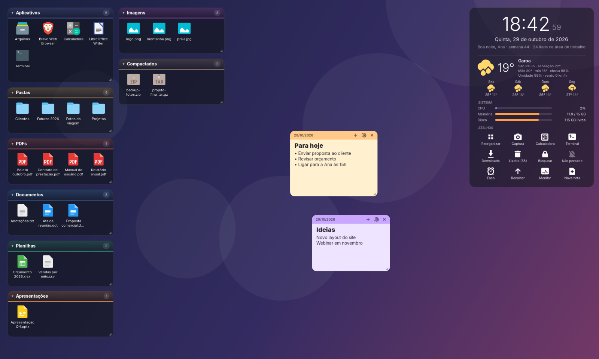

<p align="center">
  
</p>

<h1 align="center">Ordo Desktop</h1>

<p align="center">
  Organizador de área de trabalho para Linux com GNOME: caixas automáticas por tipo de arquivo,
  relógio, clima, notas adesivas e atalhos rápidos.
</p>

<p align="center">
  <a href="https://github.com/luizsant/OrdoDesktop/releases/latest"></a>
  <a href="LICENSE.md"></a>
</p>



Inspirado no "Desktop Organizer" do 360 Total Security e no Stardock Fences, o Ordo agrupa o que
está na sua Área de Trabalho em caixas por categoria e as mantém atualizadas em tempo real.
**Ele não move, renomeia nem apaga seus arquivos**: só organiza a visualização.

## Recursos

- **Caixas automáticas**: Aplicativos, Pastas, PDFs, Documentos, Planilhas, Apresentações,
  Imagens, Vídeos, Áudio, Compactados, Instaladores e Outros. Uma caixa só aparece quando tem itens.
- **Do seu jeito**: arraste as caixas pelo título, redimensione pelo canto ◢, recolha com clique
  duplo e arraste um arquivo para outra caixa (a escolha fica salva).
- **4 estilos de caixa**: Padrão, Vidro claro, Contorno colorido e Preto compacto.
- **Card de relógio** com data por extenso e, abaixo dele, os gadgets:
  - clima atual e previsão de 4 dias ([Open-Meteo](https://open-meteo.com), sem cadastro);
  - uso de CPU, memória e disco;
  - atalhos: reorganizar, captura de tela, calculadora, terminal, Downloads, lixeira,
    bloquear tela, não perturbe, timer de foco, recolher caixas, monitor e nova nota.
- **Notas adesivas** coloridas, salvas automaticamente.
- **Sem ícone na bandeja**: tudo é configurado pelo botão direito sobre qualquer caixa,
  o relógio ou uma nota.
- Inicia com o sistema e oculta os ícones nativos da área de trabalho enquanto está aberto
  (eles voltam quando o Ordo fecha).

## Instalação

### Pacote .deb (Ubuntu, Zorin OS, Pop!_OS, Linux Mint com GNOME, Debian…)

Baixe o arquivo `.deb` mais recente em
[Releases](https://github.com/luizsant/OrdoDesktop/releases/latest) e instale:

```bash
sudo apt install ./ordo-desktop_*_all.deb
```

Depois abra **Ordo Desktop** pelo menu de aplicativos. Na primeira execução ele organiza as caixas
sozinho e passa a iniciar com o sistema.

### Direto do código-fonte

```bash
sudo apt install python3-gi gir1.2-gtk-3.0
git clone https://github.com/luizsant/OrdoDesktop.git
cd OrdoDesktop
python3 ordo_desktop.py
```

### Desinstalar

Feche o Ordo (botão direito → **Sair**) e rode:

```bash
sudo apt remove ordo-desktop
```

Suas configurações ficam em `~/.config/ordo-desktop/`; apague essa pasta se quiser zerar tudo.

## Requisitos

- GNOME (testado no Zorin OS 18 / GNOME 46) em sessão **X11**.
  Em Wayland o Ordo roda via XWayland, ainda em caráter experimental.
- Python 3, PyGObject e GTK 3 (já vêm instalados na maioria das distros com GNOME).
- Opcionais: `xdotool` (botão Captura), `libnotify-bin` (aviso do timer de foco).

Ícones nativos compatíveis com a opção de ocultar: Zorin Desktop Icons, Desktop Icons NG (DING,
padrão do Ubuntu) e Gtk4 Desktop Icons NG.

## Uso rápido

| Ação | Como |
| --- | --- |
| Abrir as configurações | Botão direito no título ou área vazia de uma caixa, no relógio ou numa nota |
| Mover uma caixa ou o relógio | Arrastar pelo título (ou pelo card do relógio) |
| Redimensionar uma caixa | Arrastar o canto ◢ |
| Recolher/expandir uma caixa | Clique duplo no título |
| Trocar um arquivo de caixa | Arrastar para outra caixa, ou botão direito → Mover para a caixa |
| Escolher a cidade do clima | Botão direito no clima |
| Duração do timer de foco | Botão direito no botão Foco |

## Contribuindo

Contribuições são muito bem-vindas: correções, novas categorias, gadgets, estilos, traduções
e suporte a outras distros. Veja o [CONTRIBUTING.md](CONTRIBUTING.md) para preparar o ambiente,
testar e abrir um pull request.

## Licença

[PolyForm Noncommercial 1.0.0](LICENSE.md) © 2026 Luiz Santiago.

Em resumo: você pode usar, copiar, estudar, modificar e redistribuir o Ordo de graça, para fins
**não comerciais**. **Não é permitido vender** o Ordo nem usá-lo, ou versões modificadas, com
fins comerciais. Ao redistribuir, mantenha o arquivo `LICENSE.md` com o aviso de copyright.
Este resumo não substitui o texto da licença.

---

<details>
<summary><b>English</b></summary>

**Ordo Desktop** is a desktop organizer for GNOME-based Linux (Zorin OS, Ubuntu, Pop!_OS…),
inspired by 360 Total Security's Desktop Organizer and Stardock Fences. It groups the items on
your Desktop into auto-updating boxes by file type, and adds a clock card with weather, system
usage and quick-action gadgets, plus sticky notes. It never moves, renames or deletes your files.

Install the latest `.deb` from [Releases](https://github.com/luizsant/OrdoDesktop/releases/latest)
with `sudo apt install ./ordo-desktop_*_all.deb`, or run `python3 ordo_desktop.py` from source
(requires `python3-gi` and `gir1.2-gtk-3.0`). Right-click any box, the clock or a note to open
the settings. The UI is currently in Brazilian Portuguese; translations are welcome.
Licensed under [PolyForm Noncommercial 1.0.0](LICENSE.md): free to use, modify and share for
noncommercial purposes; selling it or any commercial use is not allowed.

</details>
